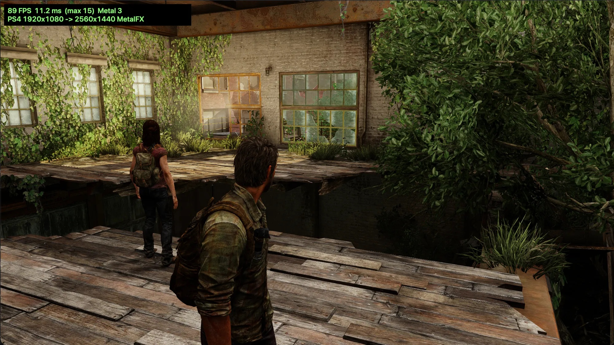
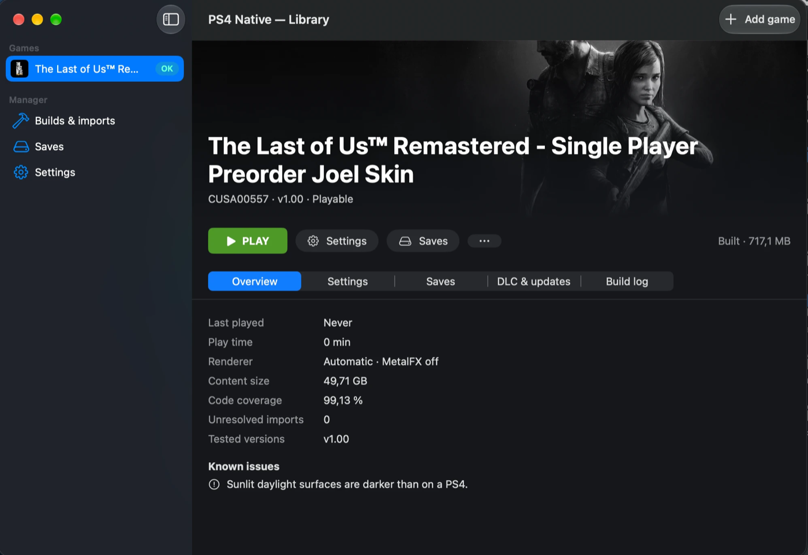
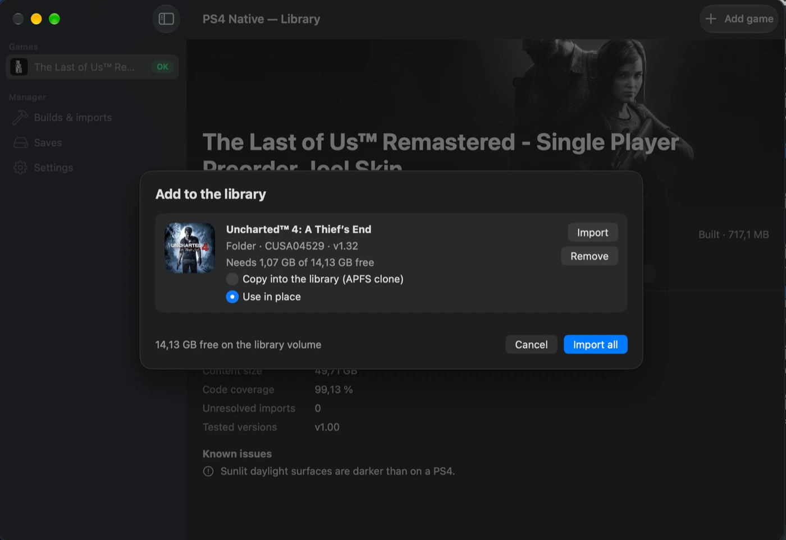
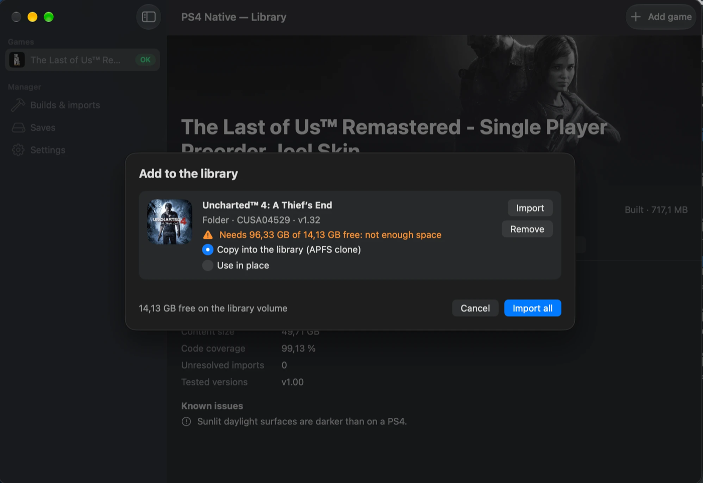
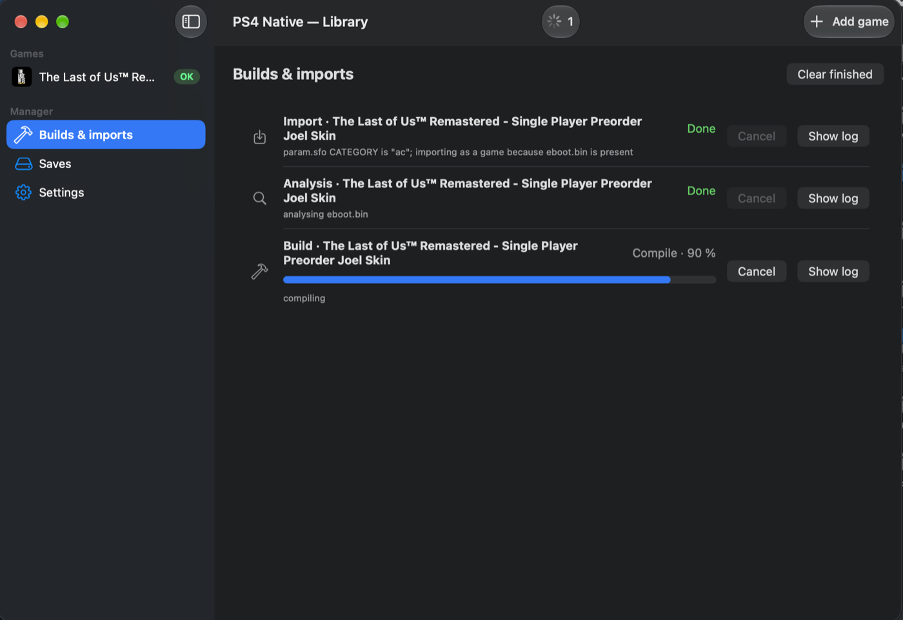
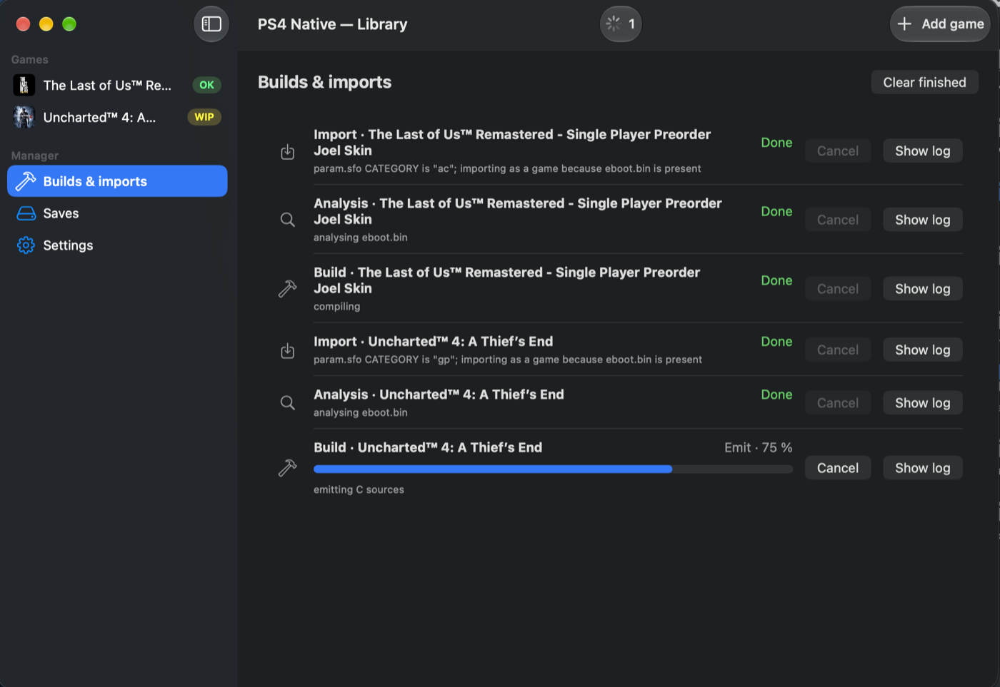
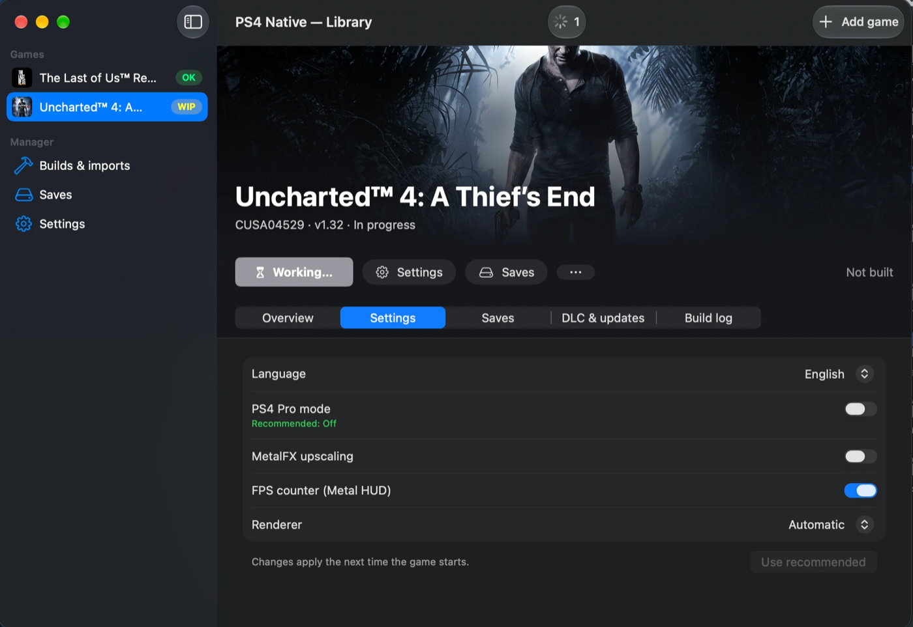

# ps4-native-mac: play PS4 games natively on Apple Silicon Macs

ps4-native-mac lets you play your own PlayStation 4 games on a Mac with Apple Silicon (M1 or
later) as native macOS apps. It is an ahead-of-time (AOT) static recompiler: it translates a PS4
game's x86-64 executables (`eboot.bin` and the PRX modules shipped with the game) into a native
arm64 `.app`. The game code is lifted once, at build time, into ARM64 assembly. It then runs
against a high-level emulation (HLE) runtime of the Orbis OS libraries and a GNM command processor
that renders with Metal. There is no JIT, no interpreter, no Rosetta and no MoltenVK.

**The Last of Us Remastered** is playable on Mac from boot to gameplay, at about 99 fps in 1080p
on a scripted chapter 1 route on an M1 Pro. **Uncharted 4: A Thief's End** is in progress: it boots
and reaches gameplay in chapter 1 at about 20 fps, with visible rendering differences from a PS4
still open. Sonic Origins Plus now reaches basic Sonic 1 and Sonic CD gameplay on Metal 3, at about 55 FPS
in the measured scenario. See [Supported games](#supported-games-on-mac) for the exact status.



*The Last of Us Remastered, "Beyond the Wall", on the Metal 3 renderer with MetalFX upscaling
from 1920x1080 to 2560x1440: about 89 fps on the developer's Mac (the overlay at the top left is
the frame-rate HUD).*

**Based on:** forked from [PS4Recomp](https://github.com/wie-project/PS4Recomp) by its authors, and
developed independently under the new name since 2026-10. License: GPL-2.0.

**Contents:** [What is this](#what-is-ps4-native-mac) ·
[Supported games](#supported-games-on-mac) · [Known issues](#known-issues) ·
[Requirements](#requirements) · [PS4 Native app](#ps4-native-app) · [Quick start](#quick-start-run-a-ps4-game-on-your-mac) ·
[FAQ](#faq) · [Configuration and debugging](#configuration-and-debugging) ·
[How it works](#how-it-works) · [Legal notice](#legal-notice)

---

## What is ps4-native-mac?

- **A recompiler, not an emulator.** The game's CPU code is converted to Apple Silicon machine code
  before you play, so the Mac runs it directly instead of interpreting or JIT-translating x86 code
  while the game runs.
- **A PS4 system layer for macOS.** The PS4 system libraries the game calls (kernel, threads,
  audio, video, saves, pad, network) are reimplemented on top of macOS frameworks such as
  AudioToolbox, VideoToolbox and GameController.
- **A Metal renderer.** The game's GPU commands are processed by a GNM command processor that
  draws with Metal; its GCN shaders are translated to Metal Shading Language and cached on disk.
  Every build contains two renderer backends, Metal 3 (the default) and Metal 4
  (`PS4_GNM_METAL=4`).

Why this approach: native code with pinned registers, x86 memory ordering mapped onto ARM
acquire/release instructions and zero-copy guest memory on unified memory keep the run-time
overhead low. The cost is that each game is built separately, and every game needs its own
bring-up work.

---

## Supported games on Mac

Measured on an Apple M1 Pro (16 GB), macOS 27.0.1 (Sonic: macOS 27.2). Only measured numbers are listed; "TBD" means
not measured yet. The TLOU/U4 results below predate 0.4.2; gameplay has not yet been
rechecked with the final 0.4.2 runtime.

| Game | Stage | fps | Resolution | Notes |
| --- | --- | --- | --- | --- |
| The Last of Us Remastered (CUSA00557) | Playable: boot, menus, movies, gameplay, saves | Chapter 1 courtyard route (300 s, median of 5 runs): **98.9 fps** on Metal 3 (the default), 85.5 fps on Metal 4. Earlier walking and standing numbers: see below. | 1920x1080 (base PS4 mode, `PS4_PRO=0`), MetalFX off. Pro mode: TBD | 30-minute courtyard soak (commit 8145002): no fatal errors, no hangs, memory footprint flat at ~3.5 GB. Exit: 3/3 by closing the window, 3/3 by terminate, no crash reports. 300 s route on Metal 3 and on Metal 4: no fatal errors, GPU errors or watchdog reports. Since v0.3.0 the colours are close to a PS4 reference in interiors and on characters; sunlit daylight surfaces are still darker (see [Colour fidelity](#colour-fidelity-tlou)). |
| Uncharted 4: A Thief's End (CUSA04529) | In progress: boots, menus, New Game, chapter 1 (boat cutscene and boat gameplay), saves, audio | Title screen about 21–22 fps, boat gameplay about 20–21 fps (`PS4_PRO=0`, 1080p, measured while other work ran on the machine). Pro mode: not re-measured (TBD) | 1920x1080 (`PS4_PRO=0`); 2560x1440 in Pro mode | Title screen: the scene is lit, but fog and light shafts are missing. Boat cutscene: Drake and Sully are lit and the motion-blur smear is fixed. Gameplay: water colour and foam differ from a PS4 and the sky is too dark. Base mode is recommended. |
| Sonic Origins Plus (CUSA30448, update 02.00) | Experimental: Sonic 1 and Sonic CD basic gameplay/control verified; Sonic 2 launcher selection verified | Sonic 1, idle Green Hill: **54.7 fps** in the measured candidate; earlier control run **55.5 fps**. Sonic CD: about 55 fps observed, not a controlled benchmark | 1920x1080, base PS4 mode (`PS4_PRO=0`), Metal 3, MetalFX off | Menu text/sky and SaveDataMemory2 persistence fixes included. Sonic 2/3 gameplay and campaign save/reload remain unverified. Metal 4 flickers and is not recommended for this title. |

How the TLOU numbers were taken:

- Route: `tools/metal4_route.sh` plays a scripted pad route from a copy of a chapter 1 save, with
  `PS4_PRO=0`, separate data and cache directories and no screenshots. `tools/metal4_perf_ab.sh`
  alternated 5 runs of 300 s per backend on one build (commit 8bdffe7) and kept only pairs taken
  under the same machine load. Noise between runs was ±1.3 fps. The full numbers are in
  [docs/metal4-baseline.md](docs/metal4-baseline.md).
- Batched compute commits (9 command buffers per frame instead of 49) raised this route from
  about 82 to 92 fps on Metal 3 in their own A/B
  ([docs/compute-batching.md](docs/compute-batching.md)).
- Earlier measurements, at commit 8145002, with a different route script, so not directly
  comparable: walking (330 s) chapter 1 courtyard 89.7 fps and spore corridor 99.6 fps, no frame
  over 100 ms; standing courtyard 78.5–78.9 fps and Sarah's house 113.7–114.5 fps.
- The frame rate is uncapped. The bench window is in the background, so vsync does not limit it.
  The machine's background load moves these numbers by a few fps between runs.
- The route numbers were taken before the v0.3.0 colour fixes. The hair and foliage shadow work
  that now runs costs about 0.4 ms of GPU time per frame in scenes with much hair and foliage; the
  route was not re-measured.

### Sonic Origins Plus

Status as of 2026-10-31: Sonic 1 and Sonic CD launch, render gameplay and accept input. Sonic 1
was also controlled by the user; Sonic CD was checked by starting a new game, pausing/resuming,
and issuing movement input. Attract-mode footage was excluded from control verification. The
base game, update 02.00 and four DLC packages are installed in the local bring-up project.

#### Measured performance

Both runs used an Apple M1 Pro with 16 GB RAM, macOS 27.2, AC power, Metal 3, 1920x1080,
`PS4_PRO=0`, MetalFX off and synchronous shader compilation with an existing cache. Automatic
confirmation stopped at 200 seconds; the measurement window was 280–320 seconds in idle
Green Hill, with physical input isolated. No compilation or GPU tests ran during that window.

| Run | Build | Median logged fps | Frame p50 | Frame p95 |
| --- | --- | --- | --- | --- |
| 34 | Control build with the preceding renderer fixes | 55.5 | 18.15 ms | 19.35 ms |
| 35 | Measured candidate: proven visible-texel write coverage and stronger save I/O error handling | **54.7** | **18.4 ms** | **19.7 ms** |

These are medians of renderer-reported telemetry windows, not independent hardware timing,
a full-game average or proof of statistical significance. The measured correctness changes did
**not** demonstrate an FPS improvement over the control run. Sustained 60 fps has not been
established. Sonic CD reached about 55 fps in a gameplay smoke run, but was not benchmarked
under this controlled scenario. No Sonic 2/3 gameplay FPS is claimed. The final 0.4.2 release
adds save-error and dense-branch regression fixes after these measurements; it was not re-benchmarked.

**Use Metal 3 for Sonic.** The Metal 4 comparison was stopped after the user observed flickering;
early telemetry was also slower. Static host readback tests passing on Metal 4 do not establish
stable live rendering.

#### Implemented fixes and current limits

- Correct display interpretation of integer textures and refresh of CPU-backed sampled images,
  resolving the earlier black-screen/stale-framebuffer failures.
- GPU aliases must cover the requested image's byte range; 3D storage textures retain their depth.
- Pending GPU buffer writes initialize color/storage images on the GPU timeline; depth-decompress
  copy handling fixes menu rendering. Full refresh now requires coverage of all consumed visible
  texels rather than an arbitrary 8 KiB prefix.
- A fixed-size CPU detile path accelerates complete single-sample 32-bit microtiles.
- SaveDataMemory2 preserves repeated setup and persists writes without requiring explicit Sync.
  Write/flush/fsync/close failures propagate before replacing the prior save. Disk writes and
  subsequent reload are verified; campaign progress across restart is not yet verified.
- The local Sonic launcher offers Sonic 1, Sonic CD, Sonic 2 and Sonic 3 & Knuckles. It selects the
  game's carousel through observed UI state and real controller input; startup notices and the
  final mode/character confirmation remain manual. Sonic 2 selection was checked live; this is
  not a Sonic 2 gameplay claim.

Measurement data: [Sonic performance report](docs/sonic-origins-performance.json).
The optional [startup chooser](examples/sonic-origins/README.md) is published separately
from game content; no game files or memory captures are distributed.

### Colour fidelity (TLOU)

The colours were compared with a PS4 reference video on location-matched frames, as CIE L\*C\*h
statistics (`tools/color_compare.py`, [docs/color-measurement.md](docs/color-measurement.md)):

| Frame | Before v0.3.0 | v0.3.0 | PS4 reference |
| --- | --- | --- | --- |
| Interior save point, median lightness (L\* p50) | 10.2 | 3.2 | 2.6 |
| Joel's hair, lightness (L\*) | 32 | 9 | 4 (hue within 20 degrees) |
| Plank courtyard in daylight, median lightness (L\* p50) | not measured | 11–19 (two captures) | 32 |

What was fixed in v0.3.0: the output gamma of `sceVideoOutAdjustColor` was applied inverted (the
image was brightened and washed out, and the in-game brightness slider went the wrong way); hair
and foliage were never shadowed (a shader buffer load mode, `addr64`, was not translated); two of
the three sun shadow cascades were always in shadow (an HTILE fast clear covered only the first
slice of the shadow depth array). Sunlit daylight surfaces are still darker than on a PS4 (see
[Known issues](#known-issues)).

**Upstream milestones (not verified in this fork):**

- Hollow Knight: Silksong: upstream reported a boot into the Unity runtime with a Metal display.
- Hogwarts Legacy: upstream reported a boot up to a virtual address space allocation failure.

---

## Known issues

- **Sonic Origins Plus:** Metal 4 flickers; use Metal 3. Sonic 2/3 gameplay and campaign
  save/reload remain unverified. The final 0.4.2 build has not been re-benchmarked.

- **The Last of Us: daylight.** Sunlit daylight surfaces are darker than on a PS4 (plank courtyard
  L\* 11–19 against 32). The sun direction is the game's own data, so the remaining difference is in
  the evaluation of lighting or shadows; it is under investigation.
- **HTILE on Pro depth arrays.** A compute HTILE fast clear of a depth array in Pro (Neo) mode
  covers only its first slice (logged); in base mode each cleared slice is covered.
- **Window colour space.** The window layer is tagged sRGB, so macOS colour-matches the frame to a
  wide-gamut panel. The effect on screen is expected, not measured; `PS4_COLORSPACE=native`
  restores the untagged layer.
- **Uncharted 4.**
  - The title screen has no fog and no light shafts.
  - In gameplay the water colour and foam differ from a PS4, and the sky is too dark.
  - Red streaks seen in boat gameplay look like the game's own damage-direction indicator (a PS4
    video of the same scene shows them too); this is not confirmed.
  - Image descriptor (T#) tables that a shader indexes at run time are bound when a bound visible
    to the CPU gives at most 8 entries. Larger tables, and indices that only the GPU knows (for
    example in the reflection-probe culling shader), read a null image; each case is counted and
    logged once per shader.
  - Decals are not applied (CMASK is not emulated).
  - The shadow cube map is resolved from a 2D target ("texture type mismatch" in the log).
  - Frame rate is below a PS4's 30 fps: about 21–22 fps on the title screen and 20–21 fps in boat
    gameplay in base mode.
  - The faster guest-memory dispatch path (`PS4_GNM_GUEST_MEMORY_FAST=1`, about 3 fps more in boat gameplay) is
    opt-in: in long runs it showed rare anomalies (a stalled dispatch, a GPU memory blow-up, one
    crash) that the default path did not show, not yet explained.
- **Metal 4 is slower than Metal 3.** On the TLOU route it runs at 85.5 fps against 98.9. Each
  Metal 4 encoder starts with a barrier after all earlier work, so its command buffers never
  overlap on the GPU (11.4 against 9.3 ms of GPU time per frame). Metal 3 stays the default until
  Metal 4 at least matches it ([docs/metal4-backend.md](docs/metal4-backend.md),
  [docs/gnm-ordering.md](docs/gnm-ordering.md)).
- **Quit after a GPU hang.** If the command buffer watchdog gave up on the GPU, a normal quit waits
  10 s for the GPU and then stops with a FATAL message.
- **x87.** 80-bit values are kept as doubles, which loses 11 mantissa bits.
- **Misaligned atomics.** A LOCK operation on an operand that crosses a 16-byte boundary raises
  SIGBUS. TLOU has none.
- **NaN sign.** The sign of NaN results from invalid operations differs from x86 (ARM default NaN).
- **Unresolved imports.** Any import without an implementation is bound to a stub that stops the
  game with a log message naming the import. TLOU has 2, in `libSceGnmDriver`; it was never seen
  calling them.
- **Screenshot frames.** With screenshots on, the frames that capture one take ~130–150 ms.
- **Shader cache sharing.** Without a TITLE_ID in `param.sfo`, the cache key falls back to the game
  folder's name, so two such games in folders with the same name share a cache.
- **Bundle ID.** Bundles get the ID `org.ps4native.<TITLE_ID>`. Without a TITLE_ID in `param.sfo`
  they fall back to `org.ps4recomp.<executable name>`, so every such `eboot.app` has the same ID.
- **macOS metadata files.** On exFAT/FAT volumes, AppleDouble `._*` files next to the PRX modules
  produce harmless "Skipping module" messages.

---

## Requirements

| Requirement | Notes |
| --- | --- |
| Apple Silicon Mac | Developed and measured on M1 Pro, 16 GB. Code is built with `-mcpu=apple-m1`. |
| macOS | Tested on macOS 27.0.1. Building a game needs the macOS 26 SDK or later (Xcode or Command Line Tools 26+), because the Metal 4 backend is compiled into every build; the game is linked for the SDK of the Mac it is built on. The bundle declares 12.0 as its minimum, but older versions are untested (TBD). MetalFX upscaling needs macOS 13 or later. The Metal 4 backend also needs a GPU with `MTLGPUFamilyMetal4`. |
| Xcode Command Line Tools | `xcode-select --install`. gcn-recompiler needs Apple clang 17+ (C++23); tested with Apple clang 21. |
| Go | `go.mod` requires Go 1.27.1. An older `go` with `GOTOOLCHAIN=auto` (the default) downloads it. |
| CMake ≥ 3.20 and Ninja | `brew install cmake ninja`. Ninja also drives the parallel game build. |
| FreeType 2 | `brew install freetype pkg-config` |

Intel Macs are not supported: the output is arm64 code for Apple Silicon.

## PS4 Native app



*The Last of Us Remastered (CUSA00557) in PS4 Native, built and ready to play: the OK badge in
the sidebar, PLAY, and the Overview tab with 99.13 % code coverage, 0 unresolved imports, the
tested version and the known issue from the compatibility database.*

PS4 Native is a Steam-style library for your own PS4 games on a Mac. It is a native SwiftUI app
that drives the recompiler in this repository, so you do not need the terminal.

The idea is that it stays simple: one window, a few clear steps.

1. **Add a game.** Drop a fake-signed PKG or a dumped game folder onto the window, or use
   **Add game**.
2. **Let it import and analyse.** The app imports the game, analyses it and shows its support
   badge.
3. **Build.** One button builds the native version in the background.
4. **Play.** Press PLAY.

The defaults are safe. Nothing is deleted without asking, saves are kept when you uninstall a game
unless you turn that off, and removed saves go to the Trash. A game folder added with "Use in
place" is only referenced, and the app never writes to it.

### Features

**Library and support badges.** The sidebar lists the games, each with its icon, name and a badge
taken from the analysis:

| Badge | Status | Meaning | Build |
| --- | --- | --- | --- |
| OK (green) | Playable | The TITLE_ID and version are listed as playable | Allowed |
| WIP (yellow) | In progress | The TITLE_ID and version are listed as in progress | Allowed |
| VER (orange) | Other version | The game is known, this version is not | After a warning that names the tested versions |
| EXP (purple) | Experimental | The TITLE_ID is not in the database | "Build anyway…" shows the analysis report first |
| ? (grey) | Not analysed | No analysis yet | — |

A retail PKG, a broken PKG or a folder without `eboot.bin` is refused at the add step and never
built. Below the games the sidebar has the manager pages: **Builds & imports**, **Saves** (every
game's saves) and **Settings**.

<table>
<tr>
<td width="50%"></td>
<td width="50%"></td>
</tr>
<tr>
<td><em>A folder used in place needs only the 1 GiB margin.</em></td>
<td><em>A copy needs the unpacked size too; the card warns when the library volume is short.</em></td>
</tr>
</table>

**Adding a game.** **Add game** accepts several items at once: a fake-signed `.pkg`, or "a game
folder named like CUSA00557 that contains eboot.bin and sce_sys/param.sfo". Drag and drop onto the
window works too. Each item is inspected first, and the **Add to the library** sheet shows a card
with its icon, title, kind, TITLE_ID and version and the space it needs on the library volume.

- A folder can be **copied into the library (APFS clone)** or **used in place**. A copy is an APFS
  clone when the folder and the library are on the same volume, and a plain copy otherwise. In place,
  the library holds only a symlink to the folder.
- The space needed is the unpacked size (nothing for a folder used in place) plus 1 GiB. The card
  shows it against the free space and warns when it does not fit.
- A retail PKG is refused with the message "this PKG is encrypted with console keys; use a dump of
  your own console or an fpkg". The engine never tries to decrypt it.
- An update (patch) PKG is laid over a copied game; a patch that arrives before its game is kept
  until the game is imported. DLC goes to `content/addcont/<entitlement>` for a copy, or to
  `games/<TITLE_ID>/addcont/<entitlement>` for a game used in place. The source folder is never
  modified; applying updates still requires a copy.

**Automatic analysis.** After an import the app runs the analysis of `eboot.bin`. It reports the
code coverage (the share of reachable code the lifter handles), the unresolved HLE imports, and the
support status from the compatibility database (`pkg/compat/compat.json`, built into the engine):
the tested versions, the recommended settings and the known issues. The result is on the Overview
tab, with last played, play time, the renderer and the content size. "Analyze again" is in the
**⋯** menu.

<table>
<tr>
<td width="50%"></td>
<td width="50%"></td>
</tr>
<tr>
<td><em>TLOU: import and analysis done, the build compiling.</em></td>
<td><em>A second game: Uncharted 4 (WIP) at the emit stage.</em></td>
</tr>
</table>

**Builds & imports.** Every import, analysis and build is a row in a queue, with its stage, a
progress bar, **Cancel** and **Show log**. Builds run one at a time; imports and analyses run one at
a time in a second lane, so one build and one import can run together. A build's bar fills in four
quarters: load, cfg and emit, then compile by finished translation units. The page offers a rebuild
when the engine is newer than the one that built the game ("Rebuild available: v… → v…"), or after
an update changes the game's version. The offer is a banner with a **Rebuild** button under the
main button, which stays **PLAY**: the old build still runs.



*Uncharted 4 (WIP, version 1.32) while it builds: the main button shows "Working…", and the
Settings tab marks the recommended value from the database.*

**The game page** has the hero art (`pic1`, `pic0`, or the blurred icon from `sce_sys`), the title,
TITLE_ID, version and status, and the main button: **Build**, **Working…** while an operation
runs, **PLAY** once built, and **Stop** while the game runs. For a game of another version, Build
first asks for a confirmation that names the tested versions; for an experimental game the button
is "Build anyway…", which opens the analysis report (coverage, unresolved imports, missing
operations, modules) and builds from there. The **⋯** menu has
Show in Finder, Open build log, Add to Applications, Analyze again and Uninstall…. The five tabs:

- **Overview:** last played, play time, renderer, content size, coverage, unresolved imports,
  tested versions and known issues.
- **Settings:** Language (the game's speech packs, or the system default), PS4 Pro mode, MetalFX
  upscaling, FPS counter (Metal HUD) and Renderer (Automatic, Metal 3 or Metal 4). A value
  recommended by the database is marked under the setting, and **Use recommended** applies them all.
  Changes are saved at once and apply the next time the game starts.
- **Saves:** the save slots with title, subtitle, date and size. **Backup** writes a zip to the
  library's `backups/`; **Restore…** (from a backup or a file) and **Import…** first back up the
  current saves and move them to the Trash; **Export…** writes a zip; **Delete slot** moves a slot to
  the Trash after a confirmation. The buttons are disabled while the game runs.
- **DLC & updates:** the installed version, the applied updates, the installed DLC, and **Add update
  or DLC…**.
- **Build log:** the newest build, run or analysis log of the game, chosen with **Build**, **Run**
  or **Analysis**, with Show in Finder.

**PLAY** starts the built `.app` with `PS4_NO_DIALOGS=1` (no launch dialog) and, when a renderer is
chosen, `PS4_GNM_METAL`. The game's output goes to `logs/<date>-run.log`. **Stop** sends SIGTERM,
then SIGKILL after 10 seconds. On exit the app adds the session to the play time and sets Last
played; after a crash the page shows "The game quit unexpectedly" with **Open log**.

**Uninstall** shows how much space it frees and has **Keep saves**, on by default. It removes
`games/<TITLE_ID>/` and the app's links in `/Applications`; with Keep saves off, the game's saves go
to the Trash. A running game, or one with an operation in the queue, cannot be uninstalled or
rebuilt.

**First run** checks Apple's Command Line Tools (clang 17 or later and the macOS 26 SDK) and the
free space, offers to install the tools if they are missing, and can import a dumped game folder from
the earlier command-line setup.

### What's inside the toolchain

| Component | Where | What it does |
| --- | --- | --- |
| PS4 Native app | `app/PS4Native` (Swift 6 package, three targets) | `PS4NativeKit`: the engine client, the library store and its lock, settings, saves, the launcher, the operation queue, the toolchain check and the view model. `PS4NativeUI`: the SwiftUI views. `PS4Native`: the executable. |
| `ps4-recomp` engine | `cmd/ps4-recomp`, `pkg/` (Go) | The `inspect`, `import`, `analyze-game`, `version` and `build` commands. Each runs as its own process; with `--json` it writes one JSON event per line (`progress`, `warning`, `error`, `done`) to stdout. Contract: [docs/game-manager-engine.md](docs/game-manager-engine.md). |
| PKG and SFO readers | `pkg/fpkg`, `pkg/sfo`, `pkg/library`, `pkg/compat` | Fake-signed PKG and PFS (also PFSC-compressed) extraction, `param.sfo`, the library and its lock, the compatibility database. |
| Recompiler | `pkg/elfloader`, `pkg/disasm`, `pkg/analyzer`, `pkg/lifter`, `pkg/emitter`, `pkg/cli` | ELF/PRX loading, function discovery, x86-64 → ARM64 assembly, the ninja build and the `.app` bundle (see [How it works](#how-it-works)). |
| HLE runtime | `pkg/runtime` (C / Objective-C) | The Orbis OS libraries on macOS, linked into every game. It finds a game's settings (`settings/<TITLE_ID>.cfg`) and saves (the save directory ending in `[<TITLE_ID>]`) by the TITLE_ID from its `param.sfo`. |
| GPU backend | `pkg/runtime/modules/libSceGnmDriver` | The GNM command processor on Metal, with a Metal 3 and a Metal 4 backend in every `.app` ([docs/metal4-backend.md](docs/metal4-backend.md)). Shaders go GCN → SPIR-V (gcn-recompiler) → MSL (SPIRV-Cross) at run time and are cached. |
| Engine kit | `tools/make_engine_kit.sh` | `ps4-recomp`, the runtime sources, the 3rdparty static libraries, `bin/ninja`, a static FreeType (with libpng) and every licence text. Its self-check builds `hello_world.elf` with no Homebrew in `PATH`. The packaged app carries it in `Contents/Resources/engine`. Licences: [docs/game-manager-app.md](docs/game-manager-app.md#bundled-tools-and-their-licences). |
| Compiler | Apple's Command Line Tools | `clang` assembles and compiles the generated code and links the game. It is not bundled. |

The library, by default `~/Library/Application Support/PS4Native/`:

```text
library.json                 the game list: title, version, patches, DLC, status, sizes, last played, play time
games/<TITLE_ID>/
  content/                   the game with updates applied, DLC in content/addcont/; a symlink when used in place
  addcont/                   DLC of a game used in place; passed to the runtime as PS4_ADDCONT_DIR
  build/                     the signed eboot.app
  logs/                      build, run and analysis logs
  analysis.json              the last analysis
backups/                     save backups
pending/<TITLE_ID>/          an update imported before its game
```

Saves and per-game settings are not in the library. The runtime keeps them in
`~/Library/Application Support/PS4Recomp/` (`saves/` and `settings/<TITLE_ID>.cfg`, with the keys
`lang`, `pro`, `upscale`, `hud` and `metal`), so saves from command-line builds keep working.
`PS4NATIVE_LIBRARY`, `PS4RECOMP_DATA_DIR` and `PS4NATIVE_ENGINE` override the locations.

### How it works, step by step

```text
 .pkg (fake-signed)            dumped folder (CUSA00557/)
        |                              |
        v                              v
 inspect        param.sfo: kind, TITLE_ID, APP_VER, title, icon0, sizes; retail PKGs refused
        |
        v
 import         PKG: PFS/PFSC extraction to games/<TITLE_ID>/content
                folder: APFS clone, copy, or a symlink (in place)
                update -> laid over copied content/; DLC -> content/addcont/<label> (copy) or addcont/<label> (in place)
        |
        v
 analyze-game   eboot.bin: coverage, unresolved imports; compat.json -> status, tested versions,
                recommended settings, known issues
        |
        v
 build          load     ELF/PRX loader, relocations, NID resolution (eboot.bin + sce_module/*.prx)
                cfg      disassembly, function discovery, jump tables
                emit     x86-64 -> ARM64 assembly in chunked .s files, small C glue, build.ninja
                compile  clang through ninja (the kit's bin/ninja), linked with the HLE runtime
                bundle   eboot.app: Info.plist from param.sfo (org.ps4native.<TITLE_ID>),
                         ad-hoc codesign, verified with --deep --strict
        |
        v
 PLAY           eboot.app runs with PS4_NO_DIALOGS=1 [PS4_GNM_METAL=3|4]
                runtime: settings/<TITLE_ID>.cfg, saves "<TITLE> [<TITLE_ID>]",
                GNM -> Metal, GCN shaders -> MSL (cached per game)
```

1. **Inspect.** The engine reads the PKG header and entries, or the folder's
   `sce_sys/param.sfo`, without writing anything. A PKG's kind comes from CATEGORY (`gd` game, `gp`
   update, `ac` DLC). The version is `APP_VER`, falling back to `VERSION`.
2. **Import.** The import holds the library lock, stages its work in `content.partial` and
   commits it by renames, so a cancel or a crash never leaves a half-written `content/`. A cancelled
   import resumes where it stopped. The import keeps a 1 GiB margin of free space.
3. **Analyse.** `analyze-game` runs the recompiler's analysis on `eboot.bin` and looks up the
   TITLE_ID and version in the database. The app stores the verdict in `library.json` and the full
   result in `analysis.json`.
4. **Recompile.** `build` turns the x86-64 code of `eboot.bin` and the game's own PRX modules into
   ARM64 assembly ahead of time. System library imports go to the HLE runtime. There is no JIT and no
   interpreter.
5. **Compile and link.** ninja runs clang on the chunks in parallel. Without ninja the engine calls
   clang directly. Cancel stops ninja and every clang process.
6. **Bundle and sign.** The result is a signed `eboot.app` in `games/<TITLE_ID>/build/`. The game's
   content directory is baked in, so the app needs no `--app-dir`.
7. **Launch.** The runtime reads the game's settings and finds its saves by TITLE_ID, and the
   renderer translates the game's GPU commands and shaders to Metal as it runs.

### Limits and notes

- **APFS only for the library.** On exFAT or FAT, macOS writes `._*` AppleDouble files next to
  files with extended attributes, and the signing of `eboot.app` fails, so every build fails after
  the compile. A folder used in place may stay on any volume; only the library's `build/` must be
  on APFS.
- **Disk use.** In place costs almost nothing beyond the build. A copy costs the game's unpacked
  size, unless it is an APFS clone on the same volume (the add sheet still counts the full size).
  The TLOU build in the screenshot is 717 MB.
- **Requirements.** An Apple Silicon Mac, macOS 26 or later (`Package.swift`, `Info.plist`) and
  Apple's Command Line Tools with clang 17 or later. The packaged app bundles ninja and FreeType, so
  Homebrew is not needed.
- **Games.** The database lists two titles: The Last of Us Remastered CUSA00557 v1.00 (playable)
  and Uncharted 4 CUSA04529 v1.32 (in progress, see [Supported games](#supported-games-on-mac)). Any other game is
  experimental.
- **Signing.** The app and the built games are signed ad hoc, not notarized. On another Mac,
  Gatekeeper blocks the first launch of a downloaded copy of the app; allow it in System Settings,
  Privacy & Security, "Open Anyway".
- **Status: preview.** Download the app as `PS4Native-0.4.2.dmg` from GitHub Releases. The app
  first shipped in v0.4.0.
  `app/PS4Native/scripts/package.sh` builds the engine kit and packages `PS4 Native.app` and a
  `.dmg`; `scripts/smoke.sh` smoke-tests that
  package with a fake engine. To run it from source, build the engine first
  (see [Quick start](#quick-start-run-a-ps4-game-on-your-mac)), then run:

```sh
PS4NATIVE_ENGINE=/path/to/engine-kit-or-repo-root swift run --package-path app/PS4Native
```

`PS4NATIVE_ENGINE` points at a directory with a built `ps4-recomp`: an engine kit or the repository
root. The app's packages, tests and environment overrides are in
[docs/game-manager-app.md](docs/game-manager-app.md); the engine protocol, result schemas and
library layout are in [docs/game-manager-engine.md](docs/game-manager-engine.md).

---

## Quick start: run a PS4 game on your Mac

These are the command-line steps; the [PS4 Native app](#ps4-native-app) runs the same steps for
you. All commands run from the repository root. `/path/to/CUSA00557` stands for your dumped game
folder, which contains `eboot.bin`, `sce_module/` and `sce_sys/`.

### 1. Clone with the third-party sources

```bash
git clone --recursive https://github.com/manjarqo/ps4-native-mac.git ps4-native-mac
cd ps4-native-mac
# already cloned without --recursive:
git submodule update --init --recursive
```

`3rdparty/gcn-recompiler` is part of this repository (not a submodule); only its build output is
ignored.

### 2. Build the third-party libraries and the recompiler

```bash
# SPIRV-Cross -> 3rdparty/spirv-cross/libspirv-cross.a
(cd 3rdparty/spirv-cross &&
  clang++ -O3 -std=c++17 -c spirv_cross.cpp spirv_cross_parsed_ir.cpp spirv_parser.cpp \
    spirv_glsl.cpp spirv_msl.cpp spirv_cfg.cpp spirv_cross_c.cpp &&
  ar rcs libspirv-cross.a *.o && rm -f *.o)

# LibAtrac9 -> 3rdparty/libatrac9/libatrac9.a
(cd 3rdparty/libatrac9 && clang -O3 -c C/src/*.c && ar rcs libatrac9.a *.o && rm -f *.o)

# gcn-recompiler -> 3rdparty/gcn-recompiler/libgcn_recompiler.a (where ps4-recomp looks for it)
cmake -S 3rdparty/gcn-recompiler -B /path/to/gcn-build -G Ninja
ninja -C /path/to/gcn-build
cp /path/to/gcn-build/libgcn_recompiler.a 3rdparty/gcn-recompiler/

# the recompiler
go build -o ps4-recomp ./cmd/ps4-recomp
```

`ps4-recomp` finds the libraries under `3rdparty/` relative to the current directory or to its own
location. Run it from the repository root, or keep the binary there. It refuses a
`libgcn_recompiler.a` that was not built from the gcn-recompiler sources next to it (the build ID
of `cmake/gcn_build_id.cmake`): rebuild and copy it again after any change there, a branch switch
or a merge.

### 3. Dump your own game

The project works only on a **decrypted, extracted** game folder. It does not decrypt or unpack PKG
files, and **no game files are provided**. Dump a game you own legally, using your own console and
the tools of your choice. The upstream project suggests
[ps4-pkg-tools](https://github.com/xXJSONDeruloXx/ps4-pkg-tools) for extracting your own backups.

Optional check of the binary and its modules:

```bash
./ps4-recomp analyze /path/to/CUSA00557/eboot.bin
```

### 4. Recompile the eboot into a .app

```bash
./ps4-recomp /path/to/CUSA00557/eboot.bin --app-dir /path/to/CUSA00557 -o /path/to/build -c
```

The result is `/path/to/build/eboot.app`. `/path/to/build/ps4_app` is the same binary outside the
bundle.

- **Game files.** The bundle holds `guest_image.bin`, `sce_sys` and the icon. At run time the game
  files are read from the `--app-dir` folder given at build time. To change that folder, set
  `PS4_APP_DIR`. `--copy-resources` copies the whole game into `Contents/Resources` instead.
- **Rebuilds.** After a runtime-only change, `ninja -C /path/to/build` relinks without lifting the
  game again. Running the full command again regenerates and rebuilds everything.
- **Build time.** For TLOU, generation takes ~25 s. A full build took ~85 s on the M1 Pro.

| Flag | Meaning | Default |
| --- | --- | --- |
| `-o`, `-out <dir>` | Output directory | `build` |
| `-e`, `-elf <file>` | Input ELF (instead of the positional argument) | — |
| `-c`, `-compile` | Assemble and link with clang | `true` |
| `-j`, `-jobs <n>` | Parallel clang jobs | number of CPUs |
| `-O`, `-opt <level>` | Clang optimization level for the C parts | `2` |
| `-k`, `-chunk-size <n>` | Functions per emitted assembly chunk | `250` |
| `-a`, `-all-symbols` | Also emit unreachable symbols | `false` |
| `-tso` | x86 memory ordering (`-tso=false` disables it, for A/B tests only) | `true` |
| `--app-dir <dir>` | Host folder mapped to `/app0` | auto-detected |
| `--copy-resources` | Copy the game files into the bundle | `false` |
| `--asan` | Build the runtime with AddressSanitizer | `false` |
| `-r`, `-run` / `-t`, `-timeout <s>` | Run after building, with an optional watchdog | `false` / `0` |
| `-v`, `-verbose` | Verbose output and timings | `false` |

### 5. Sign (ad hoc)

```bash
codesign -f -s - /path/to/build/eboot.app
codesign -v /path/to/build/eboot.app
```

Sign again after every rebuild or after replacing the executable inside the bundle.

### 6. Launch

```bash
open /path/to/build/eboot.app
# or, to see the log:
/path/to/build/eboot.app/Contents/MacOS/eboot > run.log 2>&1
```

Controllers that GameController.framework supports (DualShock 4, DualSense and others) act as the
pad.

#### Launch settings (hold Option)

A settings window opens before the game starts:

- on the first launch of a game;
- on any later launch while **Option (⌥)** is held as the app starts.

| Option | What it does | Default |
| --- | --- | --- |
| **Language** | The console system language reported to the game. The list shows only the languages whose speech packs are in your game data, and English if none are found. The first entry selected is the one matching your macOS language. | macOS language |
| **PS4 Pro mode** | The game is told it runs on a PS4 Pro (`sceKernelIsNeoMode`), so it takes its Pro rendering path. The Last of Us Remastered then renders at 3200x1800, the PS4 Pro's "4K" mode, instead of 1920x1080 on a base PS4. This costs more GPU time. | On |
| **MetalFX upscaling** | Scales the presented frame up to the window size with MetalFX spatial upscaling, for example to 3840x2160 in a full-screen window on a 4K display. It needs macOS 13 or later. Combined with PS4 Pro mode it gives 1800p → 4K; with Pro mode off it can bring 1080p up to a large window for less GPU cost. | Off |
| **FPS counter (Metal HUD)** | An on-screen overlay. It shows fps, frame time and the longest frame, the renderer backend (`Metal 3` or `Metal 4`), the mode (PS4 / PS4 Pro), the game's render resolution and, with MetalFX, the output resolution, for example `PS4 Pro 3200x1800 -> 3840x2160 MetalFX`. | On |
| **Remember** | Saves the choices for this game, so the window does not open on later launches unless Option is held. Untick it to use the choices for this launch only. | On |

How the settings are stored and overridden:

- **Storage.** Settings are kept per game in
  `~/Library/Application Support/PS4Recomp/settings/<TITLE_ID>.cfg` (the game folder name when
  `param.sfo` has no TITLE_ID). With `PS4RECOMP_DATA_DIR` set, they are kept under that directory
  instead. The file also holds `metal=3|4`, the renderer chosen in PS4 Native, which the game uses
  as `PS4_GNM_METAL` when the environment has none. Saving this window rewrites only its own four
  keys and keeps the other lines of the file.
- **Overrides.** Environment variables override the stored values: `PS4_LANG`, `PS4_PRO=0|1`,
  `PS4_UPSCALE=off|metalfx` and `MTL_HUD_ENABLED=0|1`. `PS4_NO_DIALOGS=1` (or setting `PS4_LANG`)
  never shows the window, which is useful for scripts and test runs. The log prints the resolved
  values at startup (`[ps4-settings] ...`).
- **Language and existing saves.** The language is the console language, which games use as the
  default for a new profile. TLOU stores its text, subtitle and speech language in its save. Once a
  save exists, change the language in the game's own Options menu.

TLOU's fps in PS4 Pro mode has not been measured yet (TBD); its row in the
supported-games table uses base PS4 mode.

---

## FAQ

### Can I play PS4 games on my Mac?

Some, with this project. The Last of Us Remastered is playable from start to gameplay on an Apple
Silicon Mac. Uncharted 4 boots and reaches gameplay but still has rendering issues. Other PS4 games
are not supported yet: each game needs its own bring-up work, so do not expect an arbitrary game to
run. See [Supported games](#supported-games-on-mac).

### Is this a PS4 emulator?

Not in the usual sense. The game's x86-64 CPU code is recompiled ahead of time into native arm64
code, so nothing is interpreted or JIT-compiled while the game runs. The PS4 system libraries are
reimplemented on macOS (high-level emulation, HLE), and the game's GPU commands and shaders are
translated to Metal at run time; translated shaders are cached on disk.

### Which Macs are supported?

Macs with Apple Silicon (M1, M2, M3, M4 and later), on macOS. All measurements so far were taken
on an M1 Pro with 16 GB of memory running macOS 27.0.1; other chips and older macOS versions have
not been tested. Intel Macs are not supported. See [Requirements](#requirements).

### Do I need my own copy of the game?

Yes. The project works only on a decrypted game that you dumped yourself from a copy you legally
own: an extracted game folder or a fake-signed PKG made from it. No game files, PS4 system software,
firmware or console keys are distributed with it; retail PKGs are refused.
See [Dump your own game](#3-dump-your-own-game) and the [Legal notice](#legal-notice).

### Does it use Rosetta, Wine or MoltenVK?

No. The recompiled game is a native arm64 macOS app, and the renderer uses Metal directly.

### Can I use a controller?

Yes. Controllers that GameController.framework supports (DualShock 4, DualSense and others) act as
the PS4 pad.

### Where are my saves?

In `~/Library/Application Support/PS4Recomp/saves` by default. See
[Where saves and caches live](#where-saves-and-caches-live).

### Can I share the built app?

No. The `.app` bundle, `guest_image.bin` and other build outputs contain the game's code. Build
your own from your own game copy.

---

## Configuration and debugging

### Environment variables

| Variable | Effect |
| --- | --- |
| `PS4RECOMP_DATA_DIR=<dir>` | Root for saves (`<dir>/saves`), settings, `download0` and `temp0`. Use a separate directory for test runs. |
| `PS4_SAVEDATA_DIR=<dir>` | Save root only (takes precedence over `PS4RECOMP_DATA_DIR`) |
| `PS4_APP_DIR=<dir>` | Game folder mapped to `/app0` |
| `PS4_PRO=0\|1` | PS4 Pro mode reported to the game (on by default). `0` is the base PS4 mode. |
| `PS4_UPSCALE=off\|metalfx` | MetalFX spatial upscaling to the window size (off by default) |
| `PS4_UPSCALE_FACTOR=<1..4>` | Upscale by a fixed factor instead of to the window size |
| `PS4_LANG=<code>` | System language (`en`, `ru`, `ja`, ... or an Orbis number); skips the dialog |
| `PS4_NO_DIALOGS=1` | Never show the settings dialog |
| `MTL_HUD_ENABLED=0\|1` | Metal performance HUD (its first line ends with the backend in use, `Metal 3` or `Metal 4`) |
| `PS4_GNM_METAL=3\|4` | Renderer backend (default 3). `4` needs a GPU with Metal 4 support; if it cannot start, the game stops with the reason instead of falling back (see [docs/metal4-backend.md](docs/metal4-backend.md)) |
| `PS4_GNM_COMPUTE_BATCH=0` | Commit every compute submission at its end instead of batching them (see [docs/compute-batching.md](docs/compute-batching.md)) |
| `PS4_GNM_RESIDENCY_CHECK=1` | Metal 4 only: check that every resource a command uses is resident and log each one that is not (costs encoder time) |
| `PS4_GNM_NO_SHADER_CACHE=1` | Disable the on-disk shader caches (MSL and GCN) |
| `PS4_GNM_NO_GCN_CACHE=1` | Disable only the GCN -> MSL translation cache |
| `PS4_GNM_SHADER_CACHE_MB=<n>` | Shader cache size budget |
| `PS4_GNM_NO_PSO_ARCHIVE=1` | Disable the Metal pipeline archive |
| `PS4_GNM_PSO_ARCHIVE_MB=<n>` | Pipeline archive budget (default 384) |
| `PS4_SYNC_LOG=1` | Write the log synchronously (default: an asynchronous log that is flushed on abort/exit) |
| `PS4_GNM_LOG_LONG_FRAMES=<ms>` | Log frames longer than `<ms>`, with a hitch breakdown |
| `PS4_STALL_PROFILE=<ms>` | Sample all threads during stalls longer than `<ms>` |
| `PS4_STALL_WATCHDOG=<ms>` | Report what threads do when no frame was presented for `<ms>` |
| `PS4_GNM_STATS=1`, `PS4_AUDIO_LOG=1`, `PS4_NP_LOG_ALL=1` | Command processor, audio and NP logging. Every ~2 s, `PS4_AUDIO_LOG` prints per port the outputs of the window against the grains it should have had, its longest gap between two grains (`max_gap_ms`), late grains (the ring had run empty; not counted under `PS4_AUDIO_MUTE`) and the frames of silence played (`underrun_frames`), with the `CLOCK_MONOTONIC` time (`mono`) and the longest wait for the mixer lock (`lock_wait_max_ms`); a gap over two grains also gets its own line, printed with the next stats line, with the `mono` time it ended |
| `PS4_AUDIO_DUMP=<file>` | Write the final mix to a float32 stereo 48 kHz WAV. The `frame 0 at mono` line places it on the `CLOCK_MONOTONIC` timeline of the screenshot and Videodec lines; each port's `first non-silent grain at mono` line says when sound starts. On the CoreAudio device these are the times audio reaches the device, without its own output latency, not when it is heard. The header is rewritten every second of audio and at a normal exit; a file that cannot be opened or written is reported once. A writer thread does the file I/O, never the mixer or the device, so a slow disk cannot stall the audio (the host stats line gives the longest write, `dump_io_max_ms`). If the writer falls 4 s behind, the frames that find its ring full are dropped and the WAV is shorter than the run from there; one line reports it. `tools/wav_activity.py <file>` lists the RMS per window and checks for sound |
| `PS4_AJM_LOG=1` | Log Ajm codec registration and instance creation, and every ~2 s each live instance's jobs, decoded frames, samples and errors (with the last error's result bits). An instance's totals are always printed when it is destroyed |
| `PS4_AUDIO_NULL=1`, `PS4_AUDIO_MUTE=1` | Headless audio: a clock thread mixes the ports at the device rate and plays nothing (the dump and the counters work); or no output device at all, paced by wall time |
| `PS4_VIDEODEC_LOG=1` | libSceVideodec trace: each decoder's config and resource info, its first 8 access units (size, NAL types, slices, first_mb_in_slice, pts/dts) and a progress line every 2 s, timed in raw `CLOCK_MONOTONIC` seconds (`mono`, as in the screenshot `time cadence` line). Without it, each decoder still prints one summary line when it is deleted (access units, slices, pictures, error pictures, first/last picture time and pts, frame buffer sizes) |
| `PS4_VIDEODEC_DUMP=<dir>:<i>` | Write picture `<i>` (0-based) of every libSceVideodec decoder as `<dir>/dec<n>_pic<i>.nv12` (16-byte header: u16 width, u16 height, u32 pitch, i64 pts; then the NV12 bytes the game received). `tools/nv12_to_png.py` converts it to PNG (BT.709, limited range) |
| `PS4_GNM_GPU_TIMEOUT=<ms>` | Command buffer watchdog (default 4000) |
| `PS4_SCREENSHOT_DIR=<dir>`, `PS4_SCREENSHOT_EVERY=<frames>` | Save presented frames as PNG |
| `PS4_SCREENSHOT_STAGE=render\|output` | Take screenshots before (`render`, the default) or after (`output`) the output gamma pass |
| `PS4_COLORSPACE=native` | Leave the window layer untagged instead of tagging it sRGB (the behaviour before v0.3.0) |
| `PS4_SCREENSHOT_EVERY_SEC=<s>` | Save the first frame after every `s` seconds of wall time instead, as `sec_<seconds>.png` (to compare runs at the same moments) |
| `PS4_RECOMP_HEADLESS=1`, `PS4_BACKGROUND_WINDOW=1`, `PS4_PAD_SCRIPT=...` | Automated test runs |
| `PS4_PRESENT_MODE=uncapped\|vsync\|mailbox` | Frame pacing (default `uncapped`; see [docs/present-pacing.md](docs/present-pacing.md)) |
| `PS4_GNM_CAPTURE_FRAME=<n>`, `PS4_GNM_CAPTURE_DIR=<dir>` | Capture frame `n` (see [Debugging the renderer](#debugging-the-renderer)) |
| `PS4_GNM_CAPTURE_REPLAY=<a>-<b>,...`, `PS4_GNM_CAPTURE_REPLAY_SHADER=<addr>\|pgm:<hash>,...` | Store the captured passes in a range, or the passes using a shader and the passes that produced their inputs, replayable (see [docs/gnm-capture.md](docs/gnm-capture.md)) |
| `PS4_GNM_GUEST_MEMORY_FAST=1` | Opt-in fast path for shaders that access guest memory through descriptors they load at run time (no CPU wait per dispatch; see Known issues) |
| `PS4_GNM_SYNC_ENCODE=1`, `PS4_GNM_SYNC_COMPILE=1` | Encode and compile synchronously (captures, debugging) |
| `PS4_DUMP_SHADERS=<dir>` | Write every distinct VS/PS/CS program and its registers (see [Debugging the renderer](#debugging-the-renderer)) |

**Pad motion sensors.** A DualShock 4 or DualSense connected to the Mac reports its gyro and
accelerometer through the pad data (the motion sensor is on after `scePadOpen`). Without one, the pad reads as a controller
lying still and flat (orientation (0,0,0,1), +1 g on its y axis). Hold **H** to turn that virtual
pad sideways (rolled 90 degrees, right side up), for games that ask you to tilt the controller,
and hold **N** to rattle it up and down (1 g at 6 Hz).

`PS4_PAD_SCRIPT` is a comma-separated list of steps, timed in ms from the first pad read
(`PS4_PAD_CLOCK=frames` counts flips at 30 fps instead):

| Step | Effect |
| --- | --- |
| `<t>:<hex mask>[:<dur>[:<lx>:<ly>]]` | Hold the buttons (and the left stick, 0..255) for `<dur>` ms (default 200) |
| `<t>:tilt:<roll>[:<pitch>[:<yaw>[:<turn>]]]` | Turn the virtual pad to this pose in degrees over `<turn>` ms (default 500, 0 = at once) and keep it there. From lying flat: roll about the pad's z axis (toward the player; positive raises the right side), then pitch about its own x axis (positive tilts the top face toward the player), then yaw about its own y axis (the top face's normal). Held sideways (roll 90), pitch turns it left and right and yaw up and down |
| `<t>:shake:<amp>[:<dur>[:<hz>]]` | Rattle the virtual pad up and down: `<amp>` g of vertical acceleration at `<hz>` (default 6) for `<dur>` ms (default 1000), on top of gravity |

Example: `PS4_PAD_SCRIPT=90000:tilt:90,95000:4000,120000:tilt:0` holds the pad sideways from
90 s to 120 s and presses Cross at 95 s.

Host unit tests: `tests/host/run_host_tests.sh`. Some cases need shaders dumped from your own
game (local fixtures in `tests/host/data/game/` or `PS4_HOST_GAME_FIXTURES`, never committed);
without them they are reported as SKIP and the run ends with the number of skipped cases (see
[tests/host/README.md](tests/host/README.md)).
The benchmark scripts behind the TLOU numbers are `tools/metal4_route.sh` (one route run) and
`tools/metal4_perf_ab.sh` (alternating A/B runs). They are written for the developer's workspace
(`~/ps4recomp-work`) and need your own save and pad script, which are not in the repository.

### Debugging the renderer

- **Frame capture.** `PS4_GNM_CAPTURE_FRAME=<n>` records every draw and dispatch of frame `n`:
  a manifest, a PNG and raw bytes of every output, and the guest memory each pass reads.
  See [docs/gnm-capture.md](docs/gnm-capture.md).
- **Overview.** `tools/gnm_capture_view.py <capture>` writes an HTML page listing the passes in
  order with thumbnails, to find the first pass that goes wrong.
- **Replay.** `tools/gnm_replay` runs one captured pass through the same shader translation and
  Metal code as the game and compares the result byte for byte with the capture.
  `PS4_GNM_CAPTURE_REPLAY_SHADER` selects the passes to store replayable by shader, together with
  the passes that produced their inputs, since pass indices drift between runs.
- **Fixtures.** `tools/gnm_capture_extract.py` cuts one replayable pass out of a capture as a
  minimal frame for a host test. A pass from a game's capture is game data: keep it as a local
  fixture (see [tests/host/README.md](tests/host/README.md)).
- **Reference comparison.** `tools/refcompare.py <frame.png> <reference.png>` compares mean colour
  and luminance on a 4x4 grid plus a luminance histogram. `tools/color_compare.py` compares regions
  of frame pairs as CIE L\*C\*h statistics against limits; `tools/tlou_color_run.sh` takes window
  captures through the macOS display path (see [docs/color-measurement.md](docs/color-measurement.md)).
- **Shader dumps.** `PS4_DUMP_SHADERS=<dir>` writes each distinct VS/PS/CS program as
  `<stage>_<addr>.bin` with its registers in `<stage>_<addr>.txt`.
  `3rdparty/gcn-recompiler/tools/gcn_test` translates such dumps and checks the MSL with Metal;
  `gcn_dis` disassembles them.

Captures and shader dumps contain game data: keep them outside the repository and do not share
them.

### Where saves and caches live

| Data | Default location |
| --- | --- |
| Saves | `~/Library/Application Support/PS4Recomp/saves` (or `$PS4RECOMP_DATA_DIR/saves`) |
| Settings | `~/Library/Application Support/PS4Recomp/settings/<TITLE_ID>.cfg` (the game folder name when `param.sfo` has no TITLE_ID) |
| `/download0`, `/temp0` | `~/Library/Application Support/PS4Recomp/{download0,temp0}/<TITLE_ID>` |
| Shader caches, pipeline archive | `~/Library/Caches/PS4Recomp/<TITLE_ID>/`, the game folder name when `param.sfo` has no TITLE_ID (not under `PS4RECOMP_DATA_DIR`) |

The on-disk names still say `PS4Recomp`; they come from the code and have not been renamed.

---

## How it works

```text
eboot.bin + sce_module/*.prx
  -> ELF/PRX loader, relocations, NID resolution         (pkg/elfloader)
  -> disassembly, CFG, jump tables, function discovery   (pkg/disasm, pkg/analyzer)
  -> x86-64 -> ARM64 assembly lifter                     (pkg/lifter)
  -> chunked .s files + small C glue, build.ninja        (pkg/emitter, pkg/cli)
  -> clang -mcpu=apple-m1, linked with the HLE runtime   (pkg/runtime)
  -> <name>.app bundle (guest_image.bin, sce_sys, Info.plist)
```

### Lifter (Go)

- The `ps4-recomp` tool is written in Go and decodes x86-64 with `golang.org/x/arch`.
- It discovers functions from the entry point, symbol tables, unwind info and relocations. It also
  resolves jump tables and handles overlapping instruction streams.
- It covers integer, BMI, SSE/AVX (128- and 256-bit), MMX, x87 and string instructions.
- Each guest function becomes an ARM64 assembly function. Chunks are assembled in parallel through
  ninja.
- The game's own PRX modules (for example `libc.prx` and `libSceFios2.prx` from `sce_module/`) are
  recompiled and linked statically. System library imports go to host shims.

### ARM64 assembly backend

- **Pinned guest registers.**
  - RAX–RDI map to x19–x25 and R8–R15 to x8–x15.
  - x26 holds the guest RSP, x27 the FS base (TLS) and x28 the guest memory base.
  - The XMM/YMM registers map to the vector register file.
  - Guest memory is reached as `[x28, addr]`.
- **x86 memory ordering (TSO).**
  - Scalar loads and stores to non-stack guest memory use LDAPR (load-acquire, RCpc) and STLR
    (store-release).
  - RSP- and RBP-relative accesses stay plain.
  - Accesses that cross a 16-byte boundary take a fenced fallback.
  - MFENCE lowers to `dmb ish`.
  - This is on by default (`-tso`). It adds ~31% static instructions; the measured cost is under
    1 fps.
- **LOCK prefix.**
  - Locked read-modify-write instructions use ARMv8.1 LSE atomics with acquire-release semantics:
    LDADDAL, LDCLRAL, LDEORAL, LDSETAL, SWPAL, CASAL, CASPAL.
  - Operations without an LSE form use an LDAXR/STLXR loop with DMB ISH.
- **Other.**
  - MXCSR rounding and FZ are kept across host calls.
  - RDTSC is scaled to the PS4's 2.13 GHz TSC.
  - x87 80-bit memory operands are converted to and from double.

### HLE runtime (C / Objective-C)

| Area | Implementation |
| --- | --- |
| Kernel | Guest virtual memory (direct and flexible memory, pools), VFS (`/app0`, `/download0`, `/temp0`), events/equeue, AIO, signals and exceptions, module info |
| Threads | Orbis pthreads on host threads; mutexes with an atomic fast path; `libSceFiber` as coroutines on the calling thread (`PS4_FIBER_THREADS=1` selects one host thread per fiber) |
| Audio | `libSceAudioOut` mixed and played through AudioToolbox; `libSceAjm` decodes ATRAC9 with libatrac9 and MP3 with minimp3 |
| Video | `libSceVideodec` (H.264) on VideoToolbox, with display-order output for B-frame streams |
| Saves | `libSceSaveData` mapped to host directories (see [Where saves and caches live](#where-saves-and-caches-live)) |
| Other | Pad (GameController.framework), user/system service, NP that always reports "signed out", Cocoa dialogs, FreeType, network modules (Net, Http, Ssl) |

The table also covers what Uncharted 4 needs: AAC decoding (`libSceAudiodec`, AudioToolbox),
`libSceVdecsw` (VideoToolbox) and `libSceAudio3d` (object and bed mixing to the 8-channel bus).

### Renderer: GNM on Metal

- The GNM command processor (`pkg/runtime/modules/libSceGnmDriver`) parses the guest's PM4 command
  buffers: the graphics ring, compute queues and indirect buffers.
- It tracks Liverpool register state and records Metal command buffers on a separate encoder
  thread.
- Two backends sit behind one interface (`ps4_gnm_backend.h`); `PS4_GNM_METAL` picks one at
  start and the log says which (`[gnm-draw] backend metal3 (...)`).
  - **Metal 3** (default): `MTLCommandQueue` with Metal's own hazard tracking between encoders.
  - **Metal 4**: `MTL4CommandQueue`, command allocators reused once their work completed, argument
    tables, residency sets for every resource, and a barrier at each encoder start.
  - The command processor, caches, shader translation, capture and replay are shared, and replays
    of captured TLOU frames give byte-identical outputs on both. See
    [docs/metal4-backend.md](docs/metal4-backend.md) and
    [docs/gnm-ordering.md](docs/gnm-ordering.md) for the ordering rules of each backend.
- Compute submissions are batched: while at least two command buffers are in flight, the end of a
  compute submission is held for at most 0.5 ms, so back-to-back submissions share a command
  buffer ([docs/compute-batching.md](docs/compute-batching.md)).
- Guest memory is mapped zero-copy into Metal buffers on unified memory.
- Textures are detiled and cached. GPU writes invalidate the cached copies.
- The frame is presented through `CAMetalLayer`, with optional MetalFX spatial upscaling. The
  output gamma the game sets with `sceVideoOutAdjustColor` is applied in a pass before the
  present: the encoded value is raised to 1/gamma (gamma below 1 darkens, 1.0 is the identity).
  The layer is tagged sRGB.
- Compute queues run beside the graphics ring. A compute queue that waits on memory
  (`WAIT_REG_MEM`) is suspended and resumed, so cross-queue ordering follows the guest's own
  synchronisation.
- Buffer accesses through descriptors (V#) that a shader loads at run time read and write guest
  memory directly, through a page table of zero-copy windows. Uncharted 4 builds its per-draw
  matrices this way. `addr64` buffer loads (a 64-bit address in VGPRs) are guest-memory loads in
  compute and in draw shaders; TLOU's hair and foliage shaders load their shadow-cascade matrices
  this way. Draw shaders read guest memory through read-only windows; a draw-stage store, or an
  `addr64` form that is not supported, stops the shader's translation with an error.
- A compute HTILE fast clear of a depth array covers each slice it cleared (sized from the cleared
  bytes and the HTILE layout); in Pro (Neo) mode only the first slice.
- A compute shader that reads and writes guest memory through descriptors it loads at run time
  is probed first for the guest pages it touches, which are then mapped for it. By default the
  command processor waits for each such dispatch, so later reads of guest memory see its writes.
  With the opt-in fast path (`PS4_GNM_GUEST_MEMORY_FAST=1`) it does not wait; after a barrier it
  waits for such dispatches before it reads guest memory they may have written (resource tables,
  textures), and a dispatch whose probe meets a new page runs again.
- Buffer stores over a texture the GPU owns (a render target or storage image): a store
  that covers the whole surface makes the GPU copy guest memory into the texture before it is next
  sampled; a partial store keeps the GPU-only contents.
- Image descriptor (T#) tables that a shader indexes at run time (light records, texture arrays
  behind an SRT pointer, loops over N records) are bound as separate images when the CPU can
  bound the index to at most 8 entries. A table entry written by GPU work that is still pending
  when the command processor copies the tables is read again after that work.
- GPU texture memory has a budget; unused textures are evicted.
- `sceGnmSubmitAndFlipCommandBuffers` and `sceVideoOutSubmitFlip` do not wait for the display:
  frames the presenter has not taken yet are held (at most `min(3, display buffers - 1)`), and
  their flips complete when they are shown, as on a PS4.
- A separate presenter thread shows the frames. By default (`PS4_PRESENT_MODE=uncapped`) every
  frame is shown at the next display refresh; `vsync` holds each frame for the guest's flip
  interval (`sceVideoOutSetFlipRate`). See [docs/present-pacing.md](docs/present-pacing.md).

### Shaders

```text
GCN bytecode (from guest memory)
  -> gcn-recompiler (shadPS4's shader_recompiler as a static library) -> SPIR-V
  -> SPIRV-Cross -> Metal Shading Language
  -> MTLLibrary / MTLRenderPipelineState
```

- Translated shaders are cached on disk per title: the GCN -> MSL results and the MSL sources.
- Built pipelines are stored in Metal binary archives (the PSO archive) and loaded at the next
  start, so known pipelines do not compile mid-frame.
- New shaders compile in the background.
- GCN runs 64 lanes per wave; Apple GPUs run 32-lane simdgroups, so a wave64 shader runs as two
  simdgroups. Cross-lane operations (`v_readlane`, `v_writelane`, `v_readfirstlane`, ballots,
  64-bit masks such as EXEC) see the whole wave. Code under a per-lane EXEC mask that needs the
  whole wave (cross-lane operations, workgroup memory, barriers) runs predicated on both halves,
  so every thread reaches every barrier.
- The known translation gaps are counted and logged once per shader, also when the shader comes
  from the on-disk cache: image reads of the null image (T#s loaded at run time, T# tables without
  a bound), wave64 regions the predication could not handle (left per 32-lane half), and
  `s_endpgm` in per-lane code that ends only the lanes that reach it.

### Third-party components

| Component | Location | Use | License |
| --- | --- | --- | --- |
| gcn-recompiler (from [shadPS4](https://github.com/shadps4-emu/shadPS4) `32021e4`) | `3rdparty/gcn-recompiler` (in this repository) | GCN -> SPIR-V shader translation | GPL-2.0-or-later |
| [SPIRV-Cross](https://github.com/KhronosGroup/SPIRV-Cross) | `3rdparty/spirv-cross` (submodule) | SPIR-V -> MSL | Apache-2.0 |
| [LibAtrac9](https://github.com/shadps4-emu/ext-LibAtrac9) | `3rdparty/libatrac9` (submodule) | ATRAC9 audio decoding | MIT |
| [minimp3](https://github.com/lieff/minimp3) | `3rdparty/minimp3` (submodule) | MP3 audio decoding | CC0-1.0 |

FFmpeg is not used: video decoding goes through VideoToolbox.

gcn-recompiler vendors sirit and SPIRV-Headers (BSD-3 / MIT), fmt (MIT), magic_enum (MIT) and a
Boost subset (BSL-1.0). Its README lists every change made to the shadPS4 sources.

---

## Project structure

```text
├── cmd/ps4-recomp/          # CLI entry point
├── cmd/lifter-difftest-asm/ # differential tester for the lifter
├── app/PS4Native/           # PS4 Native, the SwiftUI game manager (Swift package)
├── pkg/
│   ├── cli/                 # build driver, ninja, .app bundling, the engine commands (--json)
│   ├── fpkg/, sfo/          # fake-signed PKG / PFS extraction, param.sfo
│   ├── library/, compat/    # game library and its lock, compatibility database
│   ├── events/              # JSON event stream of the engine commands
│   ├── analyzer/            # instruction coverage and CFG analysis
│   ├── disasm/              # disassembly, function discovery, jump tables
│   ├── elfloader/           # ELF64 / PRX loader and relocations
│   ├── lifter/              # x86-64 -> ARM64 assembly lifter
│   ├── emitter/             # chunked assembly emitter, HLE shim table, trampolines
│   └── runtime/             # host runtime
│       ├── core/            # guest context, logging, startup
│       ├── kernel/          # memory, threading, sync, vfs, aio, equeue, syscalls
│       └── modules/         # libSce* HLE modules (GnmDriver, VideoOut, AudioOut, Ajm, ...)
├── tests/                   # host unit tests and runtime test programs
├── tools/                   # capture viewer, pass replay, fixture extraction, reference and colour comparison
├── docs/                    # renderer notes (backends, ordering, compute batching, capture, GPU memory budget, present pacing, colour measurement), plans
└── 3rdparty/                # see "Third-party components"
```

---

## Contributing

- macOS on Apple Silicon is the target. Changes for other platforms are welcome if they do not
  break or slow down macOS.
- AI tools may be used for development, provided the generated code is fully verified and does not
  break recompiled builds.

---

## Credits and acknowledgements

- The **PS4Recomp authors**: this project is a fork of their recompiler, runtime and tooling.
- **[shadPS4](https://github.com/shadps4-emu/shadPS4)**: HLE module architecture and system behaviour
  documentation, and the shader recompiler packaged as gcn-recompiler.
- **[OpenOrbis](https://github.com/OpenOrbis)**: open-source PS4 toolchain and reverse engineering.
- **[ps4libdoc](https://github.com/idc/ps4libdoc)**: symbol dictionaries and NID-to-name mappings.
- The authors of SPIRV-Cross, LibAtrac9 and minimp3.

---

## Legal notice

- **You must own every game you use with this project.** It works only on a game you dumped yourself
  from a copy you legally own.
- This project does not distribute game files, PS4 system software, firmware, console or retail
  encryption keys, or recompiled game binaries. The only keys in the source are the public
  fake-PKG keysets taken from shadPS4 (GPL, see `pkg/fpkg/keys.go`), which read fake-signed
  packages only. Do not share the `.app` bundles, `guest_image.bin` or other build
  outputs; they contain the game's code.
- ps4-native-mac is an independent project. It is not affiliated with, endorsed by or sponsored by
  Sony Interactive Entertainment, Naughty Dog or the original PS4Recomp authors.
- "PlayStation", "PlayStation 4", "PS4" and "Orbis OS" are trademarks of Sony Interactive
  Entertainment Inc. All game titles and assets belong to their respective owners.

---

## License

- ps4-native-mac is licensed under the [GNU General Public License v2.0](LICENSE), as was the
  PS4Recomp code it is based on.
- Files changed in this fork carry their change history in git: `git log --follow <file>` shows each
  modification, its date and its author.
- Third-party components keep their own licenses:

| Component | License |
| --- | --- |
| gcn-recompiler (from shadPS4) | GPL-2.0-or-later |
| SPIRV-Cross | Apache-2.0 |
| LibAtrac9 | MIT |
| minimp3 | CC0-1.0 |
| sirit / SPIRV-Headers, fmt, magic_enum, Boost subset (inside gcn-recompiler) | BSD-3 / MIT, MIT, MIT, BSL-1.0 |
