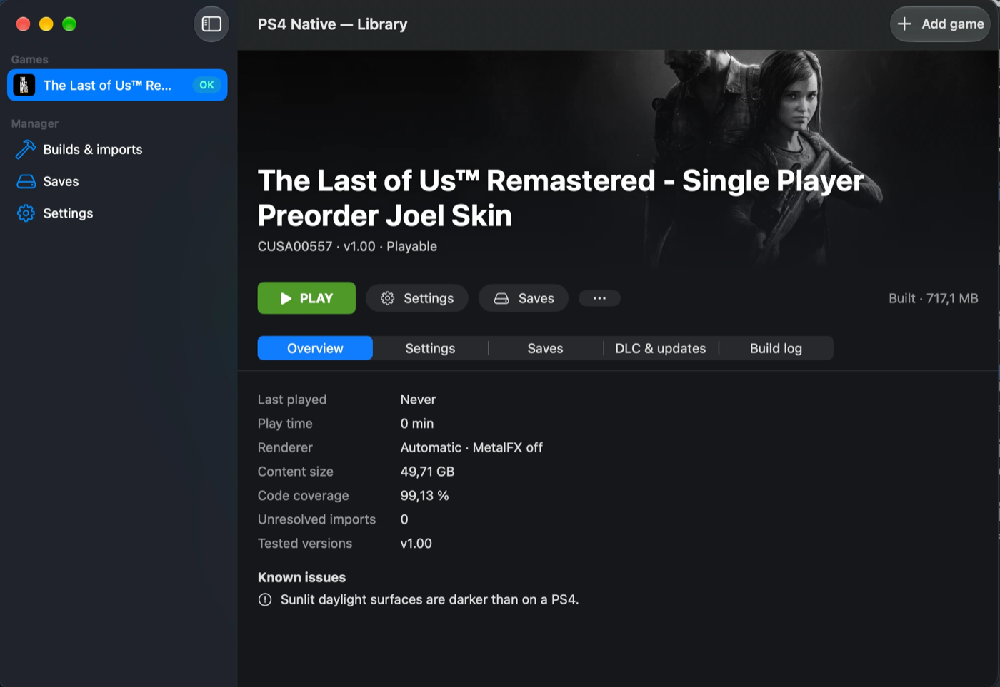

# PS4 Native — your PS4 games on a Mac

PS4 Native is a Mac app for adding, preparing and playing **your own extracted PS4 games** on
**Apple Silicon**. Use its library window to **Add game → Build → PLAY**. The downloaded app
includes the engine; you do not need to clone this repository or install Homebrew, Go or CMake.

**[Download the app](https://github.com/manjarqo/ps4-native-mac/releases/latest)** ·
[Getting started](#get-started) · [Supported games](#supported-games-on-mac) ·
[Help](#troubleshooting) · [App guide](docs/app-guide.md)

PS4 Native is an **early release**. TLOU Remastered, Sonic Origins Plus and Bloodborne have
been tested in gameplay; support depends on the game version and mode. Game files are not included.

## Before you start

- **A Mac with Apple Silicon** (M1 or newer), running **macOS 26 or later**. Intel Macs are not supported.
- **Your own extracted/decrypted copy of a PS4 game** (often called a dump), or a supported
  fake-signed `.pkg` from your own copy.
  Encrypted retail/store packages cannot be used directly. The app does not download or decrypt games.
- **Free space on an APFS drive** for the game and its Mac build. Start with the default location
  on your Mac. Setup checks for at least 30 GB free; large games may require much more, and the
  import window shows its space estimate.
- **Apple Command Line Tools with the macOS 26 SDK or newer.** These are Apple's tools used to
  prepare the game. The app checks them and offers an installer if they are missing.

## Get started

### 1. Install PS4 Native

1. Open [Releases](https://github.com/manjarqo/ps4-native-mac/releases/latest) and download
   **the `.dmg` file** from **Assets**, such as `PS4Native-0.5.0.dmg`. You do not need the
   “Source code” archives.
2. Open the DMG and drag **PS4 Native.app** into **Applications**.
3. Open PS4 Native from Applications.

The app is not notarized. If macOS blocks this downloaded copy, first try opening it, then use
**System Settings → Privacy & Security → Open Anyway** for PS4 Native.

### 2. Finish the first-run check

If the app reports missing tools, click **Install Command Line Tools** and complete Apple's
installer. Return to the app and click **Check again**. If an older SDK is reported, update Apple's
Command Line Tools / Xcode, then check again. You can revisit this in the app's **Settings**.

### 3. Add your game

1. Click **Add game**, or drag your game folder / supported `.pkg` onto the window.
2. For a folder, select the one containing **`eboot.bin`**.
3. Review the game title, version and free-space information.
4. Leave **Copy…** selected for the simplest setup, especially if you plan to install game updates.
   **Use in place** avoids another copy of the content, but its original folder and drive must stay available.
5. Click **Import**. The game appears in the library and is analysed automatically.

Have a game update or DLC? Add it through the game's **DLC & updates → Add update or DLC…**
before building when possible. [More about importing and storage](docs/app-guide.md#add-your-first-game).

### 4. Build once, then play

Select the game and click **Build**. This prepares its native Mac version. Follow progress in
**Builds & imports**; build time varies by game and Mac. Once it finishes, click **PLAY**.

Next time, just select the game and press PLAY. Keep the default settings to start;
**Metal 3** is recommended for the games below. If the app warns that a game/version is untested,
“Build anyway…” does not promise that it will run.

## Supported games on Mac

Tests used an **Apple M1 Pro with 16 GB unified memory**. The current development Mac runs
**macOS 27.2**; older TLOU route tests used 27.0.1. These are scene-specific results, not guaranteed
FPS on every Mac or a benchmark of every new release.

| Game | What has been checked | Observed FPS at 1920×1080, Metal 3 |
| --- | --- | --- |
| **The Last of Us Remastered** — CUSA00557 v1.00 | Gameplay, menus, movies and saves; reticle and controller crafting checks reported | **84.5–85.6 FPS** in the reported combat check; an older scripted route measured **98.9 FPS** |
| **Sonic Origins Plus** — CUSA30448 update 02.00 | Sonic 1 and Sonic CD gameplay/input; Sonic 2 selection only | Sonic 1 idle Green Hill: **54.7 FPS** median; Sonic CD about **55 FPS** in a short check |
| **Bloodborne GOTY** — CUSA03173 v1.09 | Offline gameplay in tested early areas | Local 60 FPS-modified candidate: **49.4–58.8 FPS** in heavier windows; about **60 FPS** in menus |
| **Uncharted 4** — CUSA04529 v1.32 | In progress; visible rendering issues remain | About **20–21 FPS** in earlier boat gameplay checks |

**Bloodborne version note:** the original 0.5.0 download does not automatically install the
60 FPS modification used in those measurements. Newer `main` source adds automatic application
for a matching v1.09 image. [Availability and rebuild requirements](docs/app-guide.md#features-in-current-main).

Sonic 2/3 gameplay is not established, Sonic flickers on Metal 4, and Bloodborne online features
are unavailable. Read the [full compatibility notes and measurement conditions](docs/performance-and-compatibility.md)
before choosing a title. A green **OK** badge describes tested compatibility, not full-game certification.

## Updating the app and your games

Download the newer DMG and replace PS4 Native in Applications. Keep your existing game folders.
When a game's page offers **Rebuild**, use it to include newer engine fixes or a game update.
The previous compiled game does not automatically gain runtime/compiler changes just because
the manager was replaced. Back up important progress from the **Saves** tab before experimenting.

Game updates and DLC are added from your own dumps through **DLC & updates**. Updates require a
copied game; a folder added with Use in place is not modified. [Full app guide](docs/app-guide.md).

## Troubleshooting

| What you see | What to do |
| --- | --- |
| macOS will not open the app | Try launching it, then check **System Settings → Privacy & Security → Open Anyway**. |
| Missing or outdated build tools | Use **Install Command Line Tools**, finish Apple's installer, then **Check again**. An old SDK needs updated Apple tools. |
| A PKG is rejected as encrypted | Use your own extracted/decrypted dump or supported fake-signed package. Retail/store packages are not decrypted by this app. |
| Not enough space / build or signing fails on an external drive | Check the space message and use an **APFS** drive for the managed build. exFAT/FAT are not suitable build destinations. |
| The game has WIP, VER or EXP status | It is unfinished, an untested version or an unknown title. Start with a listed game/version; a successful build alone does not establish playability. |
| An imported folder is missing | Reconnect the drive and restore the original folder location if you chose Use in place. |
| A game is slow, flickers or quits | Start with **Metal 3**, check that game's known issues, and open **Build log → Run** / **Open log**. First-launch shader compilation can cause stutter; persistent issues need investigation. |

For a bug report, use [GitHub Issues](https://github.com/manjarqo/ps4-native-mac/issues) and include
the app version, game ID/version, Mac model, macOS version, renderer and relevant build/run log.
Do not upload game files or saves with the report.

## More information

- [App guide: importing, updates, settings, controllers and saves](docs/app-guide.md)
- [Compatibility, detailed FPS and known rendering issues](docs/performance-and-compatibility.md)
- [Release history](CHANGELOG.md) and [downloadable releases](https://github.com/manjarqo/ps4-native-mac/releases)
- [Developer reference: source builds, CLI, configuration and architecture](docs/technical-reference.md)
- [App architecture](docs/game-manager-app.md) and [engine integration](docs/game-manager-engine.md)

## About the project

PS4 Native converts supported PS4 game code into native ARM64 code before play and implements
the system and graphics services it needs on macOS. This project is based on
[PS4Recomp](https://github.com/wie-project/PS4Recomp), with a Metal shader pipeline based on
[shadPS4](https://github.com/shadps4-emu/shadPS4). [Technical details and component credits](docs/technical-reference.md).

Use only games you own and dumped yourself. Game files, firmware, console keys and compiled
game bundles are not distributed with the project; compiled game outputs contain the game's code
and should not be shared. This independent project is not affiliated with Sony or the game studios.
Licensed under [GPL-2.0](LICENSE); third-party components retain their own licenses.
