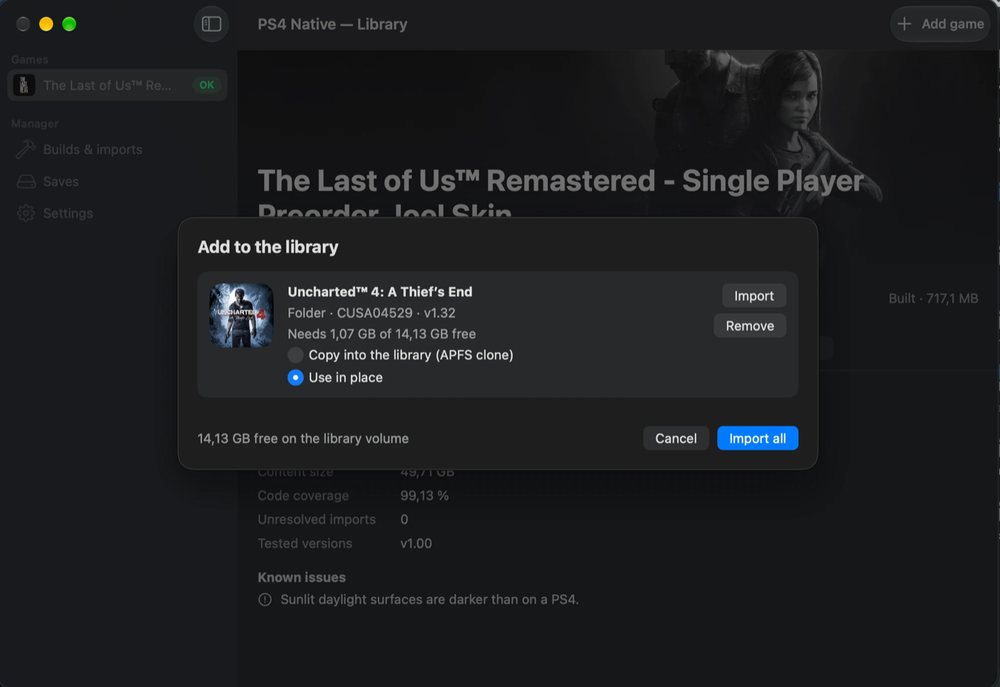
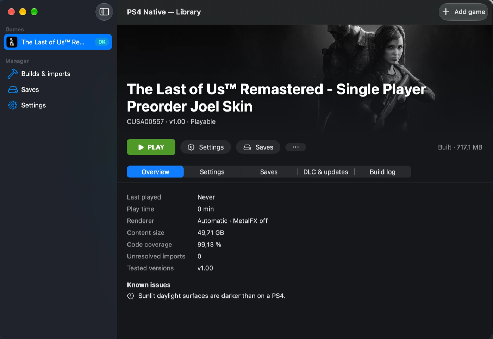

# PS4 Native app guide

[Quick start](../README.md#get-started) · [Game compatibility and FPS](performance-and-compatibility.md) · [Developer reference](technical-reference.md)

These instructions start with the published 0.5.0 app. Features added after that release are
listed separately under [Features in current main](#features-in-current-main).

## Add your first game

Choose **Add game**, or drag your own dumped game folder / supported `.pkg` into the window.
For a folder, select the folder containing `eboot.bin` and `sce_sys/param.sfo`, rather than a
parent folder containing several games. The app checks each item before importing it.

In **Add to the library**, review the title, version and required space. For a folder:

| Choice | When to use it | What to remember |
| --- | --- | --- |
| **Copy…** | The simplest option, especially if you will install updates | The app manages its own copy. On the same APFS volume it can use a space-saving clone. Trust the space check shown in the app. |
| **Use in place** | You already keep an extracted game on a drive and want to avoid another content copy | Keep that folder in its original location and the drive connected. Builds still need space on an APFS drive. Installing an update requires a managed copy. |

Click **Import**, or **Import all** for several items. Importing and analysis run automatically.
A retail/encrypted PKG cannot be imported: the app does not decrypt games or obtain console keys.

## Build and play

1. Select the imported game in the sidebar.
2. Check its support badge and the issues on **Overview**.
3. Click **Build**. This prepares the native Mac version once; you can follow progress in
   **Builds & imports**. Time varies by game and Mac, so wait for the operation to finish.
4. Click **PLAY**. On later visits, launch with PLAY without building again.

A warning for an untested version or **Build anyway…** means compatibility has not been established.
A completed build alone does not mean that the game will be playable. Start with a tested title/version.

**Stop** ends a running game. If it quits unexpectedly, use **Open log**, or open **Build log → Run**
on its page. Logs help distinguish a game compatibility issue from a failed build or missing files.

## Understand the support badges

| Badge | Meaning |
| --- | --- |
| **OK** | This game/version has a playable compatibility entry; check its known limits. |
| **WIP** | Bring-up is in progress. Gameplay may be incomplete or broken. |
| **VER** | The game is known, but this version has not been established as supported. |
| **EXP** | This game has no compatibility entry. Expect unsupported behavior. |
| **?** | Analysis has not finished or has not run. |

## Install game updates and DLC

Open the game's **DLC & updates** tab and choose **Add update or DLC…**. Import the update/DLC
from your own dump. An update can be applied to a copied game; it cannot be written into a folder
added with Use in place. DLC can be stored alongside a referenced game without changing its source folder.

Install the update before your first build when possible. After an update, use the **Rebuild**
offer to include the changed executable. The app also offers Rebuild when a newer engine version
is available. Installing a newer manager does not automatically replace already compiled game code.

## Settings and controllers

Start with the default settings. **Metal 3** is the recommended renderer for the documented
playable scenarios; Sonic has known flicker on Metal 4. Leave MetalFX off while checking an issue.

The game's **Settings** tab contains language, PS4 Pro mode, upscaling, FPS display and renderer.
Changes apply on the next launch. **Use recommended** applies the values known by the compatibility database.
DualSense, DualShock 4 and other controllers supported by macOS GameController can be used.

## Saves, backups and uninstalling

Use the game's **Saves** tab to **Backup**, **Export…**, **Import…** or **Restore…**. Save-changing
buttons are disabled while that game is running. Back up important progress before trying another
build or importing saves.

Saves are stored separately from game builds, by default in
`~/Library/Application Support/PS4Recomp/saves`. The manager's library defaults to
`~/Library/Application Support/PS4Native`. You do not need to edit either folder to play.

**⋯ → Uninstall…** offers **Keep saves**, enabled by default. Read the confirmation before changing
it. Replacing the manager app is different from uninstalling a game; keep your game folders and backups.

## Features in current main

These changes are in the source after the published **0.5.0 tag (`b81d337`)**. The original
0.5.0 DMG does not include them; do not look for these controls in that download.

- **Choose game & build location** (`bf3a761`): newer source builds show **Choose…** while adding
  a game. Pick an APFS destination for the content/build managed by the app; leave **Default**
  for normal placement. The game page also provides **⋯ → Move game…** and **Overview → Move…**.
  Use the app's move operation instead of manually moving its managed folders. A Use in place
  game's original source folder must still remain available.
- **Automatic Bloodborne v1.09 60 FPS++ patch** (`9570e68`): current source builds apply the
  frame-pacing/timestep modification during compilation only if the supported original image
  matches all expected instruction bytes. It is not a universal patch for every release or a
  guarantee of 60 FPS. It requires a fresh build; launching an old compiled game does not apply it.
  Source game files are not edited by this instruction-lowering step.

For these features, use a newer app release that explicitly lists them, or the developer source
build instructions. Check release notes instead of relying only on the version displayed by a local build.
